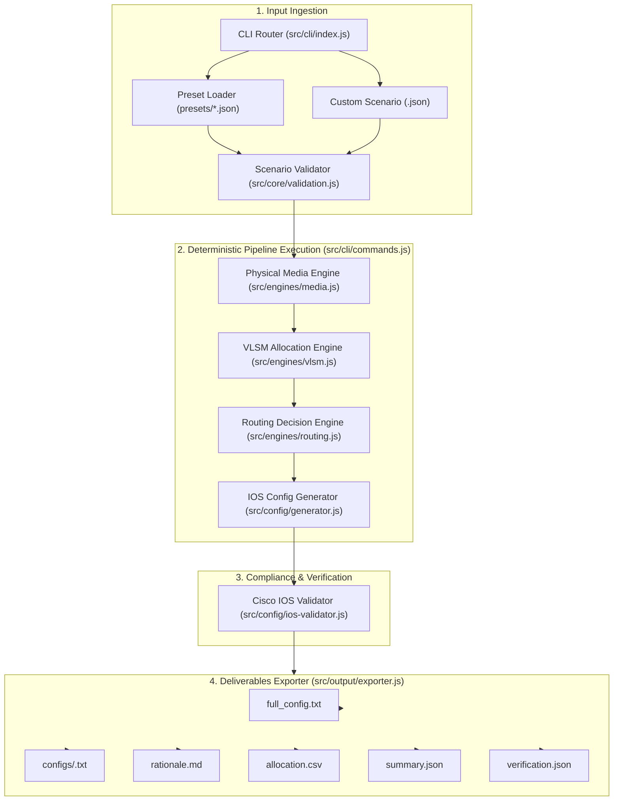
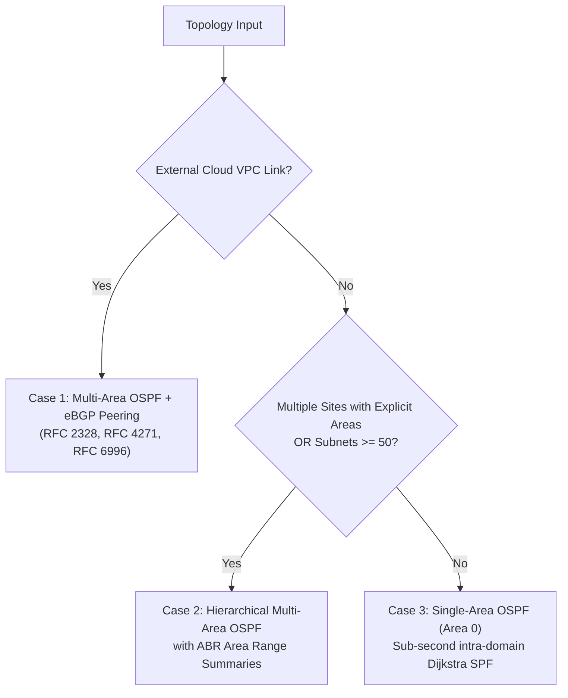

# NetArchitect Technical Documentation
**System Version:** 2.0.0 (Node.js ES Modules)  
**Implementation Language:** JavaScript (Node.js $\ge 20.0.0$)  

---

## 1. Introduction

### 1.1 Project Overview
**NetArchitect** is a deterministic network architecture compilation engine and Cisco IOS configuration generator. Built natively in modern JavaScript (ES Modules), the system consumes structured enterprise network specifications (defined as JSON topologies) and compiles them into mathematically validated IPv4 Variable Length Subnet Masking (VLSM) plans, physical transmission media selections, multi-domain routing hierarchies, and fully hardened Cisco IOS / IOS-XE device configurations.

### 1.2 Objectives
1. **Mathematical Rigor:** Eliminate human subnetting errors, off-by-one host miscalculations, and unaligned network allocations through 64-bit unsigned `BigInt` bitwise operations.
2. **Physical Layer Standards Adherence:** Enforce physical transmission distance limits per IEEE 802.3 and optical link loss budgets per ITU-T G.652 standards.
3. **Automated Control-Plane Hardening:** Generate secure, syntax-valid Cisco IOS configurations that incorporate Rapid Spanning Tree Protocol (IEEE 802.1w), dedicated Native VLAN isolation (VLAN 999), trunk allowed list pruning, access port BPDU Guard and PortFast, and OSPF passive interfaces on all client access SVIs.
4. **Deterministic Explainability:** Provide transparent engineering justifications for every architectural decision, linking choices directly to governing RFCs, IEEE standards, and physical link calculations.

### 1.3 Scope & Supported Scenarios
NetArchitect compiles three core enterprise architectural profiles:
- **Campus LAN:** Multi-building local area network with high endpoint density, OM4 multimode fiber backbones, Layer 3 switching, PoE access, and Single-Area OSPF.
- **Metropolitan Area Network (MAN):** High-speed financial or enterprise inter-branch network with single-mode fiber links spanning up to 32 km, 10GBASE-ER/ZR transceivers, dot1Q EVPL subinterfaces, and DSCP EF voice QoS priority queuing.
- **Wide Area Network (WAN):** Continental logistics network spanning thousands of kilometers, multi-area OSPF with ABR route summarization, eBGP peering to cloud provider VPCs, and IPsec VPN encryption over carrier transit links.

---

## 2. System Architecture

### 2.1 Overall Architecture
NetArchitect is organized into decoupled domain engines orchestrated by a central CLI pipeline:



### 2.2 Module Responsibilities

| Module | Location | Primary Responsibilities |
| :--- | :--- | :--- |
| **CLI Router** | `src/cli/index.js` | Direct invocation detection, command dispatching (`presets`, `run`, `validate`), argument parsing with `node:util.parseArgs`. |
| **Pipeline Orchestrator** | `src/cli/commands.js` | Preset and custom file loading, pipeline phase sequencing (Media $\rightarrow$ VLSM $\rightarrow$ Routing $\rightarrow$ Config $\rightarrow$ Export), console summary rendering. |
| **Domain Constants** | `src/core/constants.js` | IEEE 802.3 channel lengths, optical transceivers catalog (LR, ER, ZR), attenuation rates, ASNs, QoS and IPsec parameters. |
| **Domain Errors** | `src/core/errors.js` | Typed error hierarchy (`PhysicalDistanceViolationError`, `AddressSpaceExhaustedError`, `OpticalBudgetError`, `ConfigurationValidationError`). |
| **Data Models** | `src/core/models.js` | Strongly typed classes: `Scenario`, `Site`, `Device`, `Link`, `Vlan`, `MediaSelection`, `SubnetAllocation`, `Decision`, `RoutingConfig`, `DeviceConfig`. |
| **Scenario Validator** | `src/core/validation.js` | Validates RFC 1918 root prefix, link endpoints, distance positivity, unique site/device IDs, standard 802.1Q VLAN IDs, and resiliency constraints ($\ge 2$ links/site). |
| **Media Engine** | `src/engines/media.js` | Selects Cat6a UTP, OM4 MMF, OS2 SMF (LR/ER/ZR), or Carrier WAN circuits; computes optical loss budgets and link margins; checks Metro latency SLAs. |
| **VLSM Engine** | `src/engines/vlsm.js` | Implements flat and hierarchical 64-bit `BigInt` VLSM address allocation, descending sort, block-boundary alignment, RFC 3021 /31 PTP, and /32 loopbacks. |
| **Routing Engine** | `src/engines/routing.js` | Analyzes site topology, subnet scale, and cloud VPC links to select Single-Area OSPF, Multi-Area OSPF, and eBGP peering. |
| **Config Generator** | `src/config/generator.js` | Assembles hardened Cisco IOS / IOS-XE configuration files for switches and routers based on compiled parameters. |
| **IOS Validator** | `src/config/ios-validator.js` | Enforces command allowlists, audits trunk/access port security, verifies passive interfaces, detects plain-text secrets, and checks global duplicate IPs. |
| **Explainer** | `src/output/explainer.js` | Builds markdown rationale reports, CSV allocation tables, summary JSON, and verification audit payloads. |
| **Exporter** | `src/output/exporter.js` | Safely creates destination directories, purges stale device configuration text files, and writes all 7 deliverables to disk. |
| **IP Utilities** | `src/utils/ip-address.js` | BigInt conversion (`ipToBigInt`, `bigIntToIp`), CIDR parsing, subnet mask and bitwise wildcard inversion, containment and overlap checks. |

### 2.3 Execution Lifecycle & Data Flow
1. **Invocation:** The CLI parses command arguments (`run --preset campus --out exports`).
2. **Ingestion & Validation:** `loadPresetScenario()` retrieves the JSON definition; `validateScenario()` asserts schema compliance and RFC 1918 constraints.
3. **Phase 1 — Physical Media Selection:** For every link in `scenario.links`, `selectMedia()` evaluates distance, optical loss budgets, and transceiver specifications, generating `MediaSelection` records and `Decision` log entries.
4. **Phase 2 — VLSM Subnet Allocation:** VLAN host requests, point-to-point links, and loopbacks are converted into required block sizes. `allocateVlsm()` (or `allocateHierarchical()` for multi-site/cloud topologies) allocates addresses sequentially from the root prefix, generating `SubnetAllocation` objects.
5. **Phase 3 — Routing Architecture Selection:** `selectRouting()` inspects site topology, area tags, and cloud definitions to establish OSPF areas, ABR route summarization ranges, and eBGP peering parameters.
6. **Phase 4 — Cisco IOS Configuration Generation:** `generateAllConfigs()` constructs AST-like `DeviceConfig` objects and serializes them into valid Cisco IOS commands.
7. **Phase 5 — Compliance & Security Audit:** `validateAllDeviceConfigs()` parses the emitted configuration lines against `IOS_COMMAND_PREFIXES` and asserts zero IP collisions across the topology.
8. **Phase 6 — Deliverables Export:** `exportAll()` writes all per-device files, combined configs, CSVs, markdown rationale, and JSON summaries to the designated output folder.

---

## 3. Networking Decision Engine

### 3.1 Physical Media Selection Engine (`src/engines/media.js`)

#### Input Parameters
- `linkA`, `linkB`: Endpoint site or device identifiers.
- `distanceM`: Distance between endpoints in meters.
- `mediaRequest`: Optional override (`"copper"`, `"fiber"`, or `null`).
- `profile`: Scenario profile (`"campus"`, `"metro"`, `"wan"`).

#### Decision Rules
1. **Cat6a UTP Copper ($\le 100\text{ m}$):**
   - Standard: IEEE 802.3an (10GBASE-T).
   - Electrical reach: Strictly capped at 100 meters.
   - Propagation delay: $\text{distanceKm} \times 5\,\mu\text{s/km}$.
   - **Violation Rule:** If `mediaRequest === "copper"` and `distanceM > 100`, the engine throws `PhysicalDistanceViolationError` citing IEEE 802.3an alien crosstalk and insertion loss constraints.
2. **OM4 Multimode Fiber ($101\text{ m} - 400\text{ m}$):**
   - Standard: IEEE 802.3ae (10GBASE-SR, $850\text{ nm}$ VCSEL).
   - Modal bandwidth limit: $4,700\,\text{MHz}\cdot\text{km}$, allowing 10 Gbps transmission up to 400 m.
   - Rejection of Copper: Cites high-frequency attenuation and alien crosstalk beyond 100 m.
3. **OS2 Single-Mode Fiber ($401\text{ m} - 80\text{ km}$):**
   - Standard: ITU-T G.652 / IEEE 802.3ae.
   - Evaluates optical power loss budget across transceivers in cost order: `10GBASE-LR` ($1310\text{ nm}$, $10\text{ km}$) $\rightarrow$ `10GBASE-ER` ($1550\text{ nm}$, $40\text{ km}$) $\rightarrow$ `10GBASE-ZR` ($1550\text{ nm}$, $80\text{ km}$).
   - Optical budget formula:
     $$\text{Budget (dB)} = \text{Tx}_{\min} - \text{Rx}_{\text{sens}}$$
     $$\text{Total Loss (dB)} = (D_{\text{km}} \times \alpha) + L_{\text{conn}} + L_{\text{splice}} + M_{\text{safety}}$$
     Where:
     - $\alpha_{1310} = 0.35\text{ dB/km}$, $\alpha_{1550} = 0.25\text{ dB/km}$ (ITU-T G.652).
     - $L_{\text{conn}} = 4 \times 0.5\text{ dB} = 2.0\text{ dB}$ (2 patch panels $\times$ 2 connectors).
     - $L_{\text{splice}} = \lfloor D_{\text{km}} / 2 \rfloor \times 0.1\text{ dB}$ (standard 2 km fiber spool reels).
     - $M_{\text{safety}} = 2.0\text{ dB}$ (aging, temperature, and macro-bend allowance).
     $$\text{Link Margin (dB)} = \text{Budget} - \text{Total Loss}$$
   - Selection condition: First transceiver in cost order where $\text{reachKm} \ge D_{\text{km}}$ and $\text{Link Margin} \ge 0.0\text{ dB}$.
   - Failure condition: If no transceiver achieves positive margin, throws `OpticalBudgetError`.
4. **Carrier WAN Transit ($> 80\text{ km}$):**
   - Beyond 80 km dark fiber limits, private unamplified glass is commercially and physically unviable.
   - Recommends Carrier Ethernet / EVPL transit secured via IPsec tunnel encryption per RFC 4301.
5. **Metro MAN Latency Verification:**
   - For `profile === "metro"`, calculates total one-way transit delay:
     $$\text{Latency} = \left(\frac{D_{\text{km}} \times 5\,\mu\text{s/km}}{1000}\right) + 1.0\text{ ms (equipment queuing allowance)}$$
   - Asserts delay satisfies the financial realtime voice SLA ($< 5.0\text{ ms}$).

---

### 3.2 IP Addressing & VLSM Allocation Engine (`src/engines/vlsm.js`)

#### Arithmetic Foundation
JavaScript standard `Number` uses IEEE 754 double-precision floats, where bitwise operations (`|`, `&`, `~`, `^`) cast operands to 32-bit *signed* integers. Inverting `0xFFFFFF00` produces `-256` instead of `4294967040`. To guarantee complete precision, NetArchitect performs all IP calculations using 64-bit unsigned `BigInt`:
$$\text{ipBigInt} = (O_1 \ll 24) + (O_2 \ll 16) + (O_3 \ll 8) + O_4$$
$$\text{maskBigInt} = (0\text{xFFFFFFFFn} \ll \text{BigInt}(32 - \text{prefixLen})) \ \& \ 0\text{xFFFFFFFFn}$$
$$\text{wildcardBigInt} = (\sim \text{maskBigInt}) \ \& \ 0\text{xFFFFFFFFn}$$

#### Block Sizing & Subnet Allocation
1. **Block Sizing:**
   - Standard Subnets: $\text{Block Size} = \text{nextPowerOf2}(\text{hostsRequested} + 2)$. Requires $+2$ for Network ID and Directed Broadcast.
   - RFC 3021 Point-to-Point Links: When `allowSlash31: true`, block size is 2 (/31 prefix, 2 usable host addresses, no dedicated broadcast).
   - Loopback Interfaces: Exactly 1 address (/32 host route).
2. **Descending Allocation Order:**
   - Subnet requests are sorted descending by block size:
     $$\text{Block}_{i} \ge \text{Block}_{i+1}$$
   - Sorting descending guarantees optimal space packing and guarantees that subnets can be boundary-aligned without fragmentation gaps.
3. **Boundary Alignment & Overlap Prevention:**
   - The address cursor advances strictly to a multiple of the current block size:
     $$\text{offset} = \text{cursor} \pmod{\text{blockSize}}$$
     $$\text{alignedAddress} = \text{cursor} + (\text{blockSize} - \text{offset}) \quad [\text{if } \text{offset} \neq 0]$$
   - Because each block size is a power of 2 and aligned to a multiple of itself, subnets are mathematically guaranteed never to overlap.
4. **Hierarchical Multi-Site Mode:**
   - For WAN topologies with multiple areas or cloud links, `allocateHierarchical()` calculates total demand per site, sizes a site aggregate supernet to the next power of 2, aligns site supernets, and sub-allocates VLANs within each site supernet. This enables OSPF Area Border Routers (ABRs) to summarize internal routes using `area range`.
5. **Address Space Exhaustion:**
   - If $\text{cursor} + \text{blockSize} > \text{rootEnd}$, the engine halts immediately and throws `AddressSpaceExhaustedError` reporting requested versus remaining capacity.

---

### 3.3 Topology-Aware Routing Engine (`src/engines/routing.js`)

Routing protocol selection is driven by topology architecture, administrative boundaries, and external cloud links—**not** simply by counting subnets.



#### Selection Criteria
1. **Case 1: Multi-Area OSPF + eBGP Peering (`protocol: "ospf+bgp"`)**
   - **Trigger:** Multiple physical sites combined with an external cloud VPC connection (e.g., AWS Transit VPC).
   - **Mechanism:** Internal inter-site routing uses OSPF (Area 0 backbone plus regional non-zero areas). External transit to the cloud provider uses Exterior BGP (RFC 4271) across Private Autonomous System Numbers (RFC 6996): On-Premises ASN 65001 peering with Cloud Provider ASN 65010.
   - **Justification:** Cloud VPCs operate as independent administrative routing domains. BGP provides policy routing, AS-Path loop prevention, and automated prefix filtering that interior gateway protocols cannot provide.
2. **Case 2: Hierarchical Multi-Area OSPF (`protocol: "ospf"`, `isMultiArea: true`)**
   - **Trigger:** Multiple physical sites with explicit area partitions or aggregate subnet count $\ge 50$.
   - **Mechanism:** Distributes sites into discrete non-backbone areas attached to Backbone Area 0. Core ABR routers emit `area <id> range <prefix> <mask>` statements.
   - **Justification:** Confines Type-1 and Type-2 Link State Advertisement (LSA) flooding to local areas. Prevents local interface flaps from triggering Dijkstra SPF recalculations across WAN links.
3. **Case 3: Single-Area OSPF (`protocol: "ospf"`, `isMultiArea: false`)**
   - **Trigger:** Single autonomous domain, single-site enterprise, or Metro MAN with $< 50$ subnets.
   - **Mechanism:** All interfaces participate in Backbone Area 0 (`router ospf 1`, `network <net> <wildcard> area 0`).
   - **Justification:** Provides sub-second Dijkstra convergence without the operational complexity of ABR summarization or virtual links.

---

### 3.4 Cisco IOS Configuration Generation & Hardening (`src/config/generator.js`)

The generator translates compiled models into standard Cisco IOS / IOS-XE command blocks:

1. **Layer 2 Security Hardening:**
   - **Native VLAN Isolation:** All switches configure `vlan 999` named `NATIVE`. Trunk ports enforce `switchport trunk native vlan 999`, neutralizing double-tagged 802.1Q VLAN hopping attacks (CVE-2001-0860).
   - **Trunk Allowed Lists:** Emits `switchport trunk allowed vlan <list>`, preventing unauthorized VLAN broadcast flooding.
   - **Access Port Protections:** All access ports enforce:
     ```text
     switchport mode access
     spanning-tree portfast
     spanning-tree bpduguard enable
     ```
     This bypasses listening/learning delays for end hosts while disabling the port if a rogue switch sends BPDUs.
   - **Spanning Tree Architecture:** Enforces Rapid Spanning Tree (`spanning-tree mode rapid-pvst`). Designated core root switches configure `spanning-tree vlan <id> priority 4096`.
   - **Power over Ethernet (PoE):** Access ports supporting Wi-Fi APs configure `power inline auto`.
2. **Layer 3 SVI & Inter-VLAN Routing:**
   - Switches enable `ip routing`.
   - Generates Switched Virtual Interfaces (`interface Vlan<id>`) with first usable IP addresses.
   - Point-to-point inter-switch links configure `no switchport` with dedicated /30 or /31 subnets.
3. **Metro EVPL Subinterfaces:**
   - For Metro MAN router handoffs, generates dot1Q subinterfaces:
     ```text
     interface GigabitEthernet0/1.10
      description EVPL HQ-Trading-Users
      encapsulation dot1Q 10
      ip address 172.16.0.1 255.255.255.0
     ```
4. **OSPF Dynamic Routing:**
   - Emits `router ospf 1` with router-ids derived from `Loopback0`.
   - Generates exact bitwise inverted wildcard masks in `network` statements.
   - Client access SVIs and EVPL subinterfaces configure `passive-interface` to stop OSPF hello multicasts (`224.0.0.5`) on user-facing links.
   - ABR routers emit `area <id> range <summary-ip> <subnet-mask>`.
5. **eBGP Peering:**
   - Generates `router bgp 65001`, `neighbor <cloud-ip> remote-as 65010`, and `neighbor <cloud-ip> description AWS-Transit-VPC`.
6. **Access Control Lists (ACLs):**
   - Generates extended named ACLs (e.g. `STUDENT-RESTRICTION-ACL`) denying student access to RFC 1918 management and data center subnets while permitting outbound web access.
7. **Metro Voice QoS:**
   - Generates classification and priority queuing:
     ```text
     class-map match-all VOICE-CLASS
      match dscp ef
     policy-map QOS-POLICY
      class VOICE-CLASS
       priority percent 30
     interface GigabitEthernet0/1
      service-policy output QOS-POLICY
     ```
8. **IPsec VPN Over WAN Transit:**
   - Emits ISAKMP policies (`encryption aes 256`, `hash sha256`, `group 14`), transform sets (`esp-aes 256 esp-sha256-hmac`), and crypto map bindings.

---

## 4. Explainability Framework

NetArchitect generates an audit record for every engineering decision via structured `Decision` objects:
- `ruleId`: Standard identifier (e.g. `MEDIA-001`, `VLSM-004`, `ROUTE-001`, `SECURITY-001`).
- `domain`: Functional area (`media`, `vlsm`, `routing`, `security`, `qos`).
- `subject`: The link, subnet, or device being decided.
- `choice`: Selected technical option.
- `reason`: Justification containing computed numbers (e.g. distance, attenuation, required hosts, usable capacity, link margin).
- `references`: Formal standards (IEEE 802.3, RFCs, ITU-T).
- `alternative`: Alternative considered.
- `rejectionReason`: Reason why the alternative was rejected.

All decisions are compiled dynamically into `rationale.md` and `summary.json`.

---

## 5. Command-Line Interface (CLI) Reference

### 5.1 Invocation
```bash
# General Syntax
node src/cli/index.js <command> [options]
```

### 5.2 Available Commands

#### `presets`
Lists all built-in scenarios with a summary of their specifications.
```bash
node src/cli/index.js presets
```

#### `run`
Executes the end-to-end design pipeline.
```bash
# Run built-in preset
node src/cli/index.js run --preset <campus|metro|wan> [--out <dir>]

# Run custom scenario file
node src/cli/index.js run --custom <path/to/scenario.json> [--out <dir>]
```
- `--preset <name>`: built-in scenario (`campus`, `metro`, `wan`).
- `--custom <path>`: path to custom JSON scenario.
- `--out <dir>`: output directory (default: `out`).

#### `validate`
Validates a custom scenario without generating output files.
```bash
node src/cli/index.js validate --custom presets/campus.json
```

### 5.3 Exit Codes
- `0`: Success.
- `1`: Invalid CLI arguments or unrecognized command.
- `2`: Domain validation error (e.g. `PhysicalDistanceViolationError`, `AddressSpaceExhaustedError`, `OpticalBudgetError`, `ConfigurationValidationError`).

---

## 6. Built-In Scenario Presets

### 6.1 Campus LAN Preset (`presets/campus.json`)
- **Institution:** St. Jude University Campus LAN
- **Root Prefix:** `10.10.0.0/16`
- **Topology:** 3 sites (`Admin-Hall`, `Science-Complex`, `Residential-Quad`), 3 Layer 3 Switches (`CORE-ADMIN`, `DIST-SCIENCE`, `DIST-RESI`).
- **Links:**
  - Admin-Hall $\leftrightarrow$ Science-Complex: 180 m (OM4 MMF, 10GBASE-SR)
  - Admin-Hall $\leftrightarrow$ Residential-Quad: 360 m (OM4 MMF, 10GBASE-SR)
  - Science-Complex $\leftrightarrow$ Residential-Quad: 250 m (OM4 MMF, 10GBASE-SR)
- **Subnets & Endpoints:** Exactly **1,600 endpoints** across 8 VLANs:
  - VLAN 10 (Admin-Staff): 200 hosts (`10.10.6.0/24`)
  - VLAN 20 (DataCenter-Servers): 60 hosts (`10.10.8.128/26`)
  - VLAN 30 (Network-Mgmt): 40 hosts (`10.10.8.192/26`)
  - VLAN 40 (CCTV-Security): 30 hosts (`10.10.9.0/27`)
  - VLAN 50 (Faculty-Offices): 250 hosts (`10.10.7.0/24`)
  - VLAN 60 (Research-Labs): 300 hosts (`10.10.4.0/23`)
  - VLAN 70 (Campus-Wi-Fi-APs): 120 hosts with PoE (`10.10.8.0/25`)
  - VLAN 80 (Student-Dorms): 600 hosts (`10.10.0.0/22`)
- **Routing:** Single-Area OSPF (Area 0 Backbone).
- **Hardening:** Rapid Spanning Tree (`priority 4096` on `CORE-ADMIN`), Native VLAN 999, Student Dorm Extended ACL.
- **Output:** `exports/campus/`

### 6.2 Metro MAN Preset (`presets/metro.json`)
- **Institution:** Apex Financial Metro MAN
- **Root Prefix:** `172.16.0.0/16`
- **Topology:** 3 sites in a triangle (`FinTech-HQ`, `Branch-East`, `Branch-West`), 3 routers (`RTR-FINTECH-HQ`, `RTR-BRANCH-EAST`, `RTR-BRANCH-WEST`).
- **Links:**
  - FinTech-HQ $\leftrightarrow$ Branch-East: 18,500 m (18.5 km, OS2 SMF, 10GBASE-ER, margin +4.03 dB)
  - FinTech-HQ $\leftrightarrow$ Branch-West: 32,000 m (32.0 km, OS2 SMF, 10GBASE-ZR, margin +9.55 dB)
  - Branch-East $\leftrightarrow$ Branch-West: 24,000 m (24.0 km, OS2 SMF, 10GBASE-ER, margin +2.65 dB)
- **Subnets & Endpoints:** Exactly **450 user endpoints** + 100 colo server endpoints:
  - VLAN 10 (HQ-Trading-Users): 250 hosts (`172.16.0.0/24`)
  - VLAN 20 (Colo-Trading-Servers): 100 hosts (`172.16.1.0/25`)
  - VLAN 30 (East-Branch-Users): 120 hosts (`172.16.1.128/25`)
  - VLAN 40 (West-Branch-Users): 80 hosts (`172.16.2.0/25`)
- **Routing:** Single-Area OSPF (Area 0).
- **Features:** Dot1Q EVPL subinterfaces, Voice QoS class-map and policy-map with 30% priority queuing.
- **Output:** `exports/metro/`

### 6.3 Global WAN Preset (`presets/wan.json`)
- **Institution:** TransGlobal Logistics Global WAN
- **Root Prefix:** `10.100.0.0/16`
- **Topology:** 4 city hubs (`Delhi-Hub`, `Mumbai-Logistics`, `Bengaluru-TechCenter`, `Chennai-Terminal`), 4 routers (`RTR-DELHI`, `RTR-MUMBAI`, `RTR-BENGALURU`, `RTR-CHENNAI`).
- **Links:**
  - Delhi $\leftrightarrow$ Mumbai: 1,400 km (Carrier WAN / IPsec)
  - Delhi $\leftrightarrow$ Bengaluru: 2,150 km (Carrier WAN / IPsec)
  - Delhi $\leftrightarrow$ Chennai: 2,200 km (Carrier WAN / IPsec)
- **Subnets & Endpoints:** Exactly **2,000 IoT scanner endpoints** + 200 srv/mgmt endpoints:
  - Delhi: 800 IoT, 30 mgmt, 20 servers (Site aggregate `10.100.0.0/21`)
  - Mumbai: 500 IoT, 30 mgmt, 20 servers (Site aggregate `10.100.16.0/22`)
  - Bengaluru: 400 IoT, 30 mgmt, 20 servers (Site aggregate `10.100.12.0/22`)
  - Chennai: 300 IoT, 30 mgmt, 20 servers (Site aggregate `10.100.8.0/22`)
  - Inter-site PTP links: RFC 3021 /31 subnets (`10.100.20.0/31`, `10.100.20.2/31`, `10.100.20.4/31`)
- **Routing:** Hierarchical Multi-Area OSPF:
  - Delhi-Hub: Area 0 Backbone
  - Mumbai-Logistics: Area 1
  - Bengaluru-TechCenter: Area 2
  - Chennai-Terminal: Area 3
  - ABR Summaries: RTR-DELHI emits `area range` for Areas 1, 2, and 3.
  - eBGP Peering: Peering with AWS Transit VPC (`10.200.0.0/16`, ASN 65010).
- **Output:** `exports/wan/`

---

## 7. Custom Scenario Schema

Custom topologies can be defined as JSON files:

```json
{
  "profile": "custom-enterprise",
  "root_prefix": "192.168.0.0/16",
  "resiliency": true,
  "sites": [
    {
      "name": "Site-A",
      "devices": [{ "name": "RTR-A", "type": "router" }],
      "area": 0
    },
    {
      "name": "Site-B",
      "devices": [{ "name": "RTR-B", "type": "router" }],
      "area": 0
    }
  ],
  "links": [
    { "a": "Site-A", "b": "Site-B", "distance_m": 85 }
  ],
  "vlans": [
    { "id": 10, "name": "Staff-LAN", "hosts": 100, "site": "Site-A" },
    { "id": 20, "name": "Branch-LAN", "hosts": 50, "site": "Site-B" }
  ],
  "extras": {
    "allow_slash31": true
  }
}
```

### Schema Rules & Validation
- `profile` (string, required): Scenario name.
- `root_prefix` (string, required): Valid RFC 1918 CIDR prefix (`10.0.0.0/8`, `172.16.0.0/12`, `192.168.0.0/16`). Prefix length must be $\le 30$.
- `sites` (array, required): At least 1 site. Site names must be unique. Device names must be unique across all sites.
- `links` (array, required): Must specify valid `a` and `b` endpoints matching declared site or device names. `distance_m` must be a positive number.
- `resiliency` (boolean, optional): If `true`, every site must have $\ge 2$ physical links.
- `vlans` (array, required): `id` must be between 1 and 4094 (excluding reserved 1002–1005). `id` must be unique across all VLANs. `hosts` must be a positive integer. `site` must match a declared site name.

---

## 8. Generated Deliverables Structure

Every execution writes the following deliverables to `<outDir>/<profile>/`:

```text
exports/<profile>/
├── full_config.txt              # Merged Cisco IOS configuration script
├── <profile>_full_config.txt    # Profile-named copy of merged configuration
├── configs/                     # Per-device configurations
│   ├── <device-1>.txt
│   └── <device-2>.txt
├── rationale.md                 # Complete technical rationale with standards citations
├── allocation.csv               # IPv4 VLSM subnet allocation table
├── summary.json                 # High-level architecture and link metrics JSON
└── verification.json            # Automated security and syntax audit report
```

### File Details
- `full_config.txt`: All per-device configurations concatenated into a single file separated by headers.
- `rationale.md`: Formatted Markdown report detailing all physical media decisions (distance, standard, transceiver, margin), VLSM subnet allocations (hosts requested, usable capacity, efficiency), routing protocol choices, and security controls.
- `allocation.csv`: Comma-separated table formatted with headers: `Name,Site,Network,Prefix,SubnetMask,Wildcard,Broadcast,Gateway,FirstUsable,LastUsable,UsableCount,HostsRequested,Efficiency`.
- `summary.json`: Machine-readable summary containing profile metadata, total subnets, host capacity, utilization percentage, and link loss calculations.
- `verification.json`: Security audit record reporting `status: "PASS"` or `"FAIL"`, device list, line counts, and boolean check results.

---


